# Week 2 — DevOps Lifecycle Architecture & Workflow

The diagram below illustrates the end-to-end automated DevOps lifecycle for the **Public Transport Feedback Portal**, showing the continuous feedback loop from planning through release and operations.

```mermaid
flowchart LR
    subgraph Plan ["1. PLAN"]
        A[GitHub Projects & User Stories]
    end

    subgraph Code ["2. CODE"]
        B[VS Code / IntelliJ] --> C[Git & GitHub PR Workflow]
    end

    subgraph Build ["3. BUILD"]
        D[Maven 3.9 clean package]
    end

    subgraph Test ["4. TEST"]
        E[JUnit 5 Unit Tests] --> F[Selenium WebDriver UI Tests]
    end

    subgraph Release ["5. RELEASE"]
        G[Docker Image Build & Push to Docker Hub]
    end

    subgraph Deploy ["6. DEPLOY"]
        H[Jenkins Declarative Pipeline CD]
    end

    subgraph Operate ["7. OPERATE & PROVISION"]
        I[Ansible Playbooks & Health Check]
    end

    subgraph Monitor ["8. MONITOR"]
        J[Spring Boot Actuator & Feedback Loop]
    end

    A --> B
    C -->|Trigger Webhook / Polling| D
    D --> E
    F -->|Quality Gate Passed| G
    G --> H
    H --> I
    I --> J
    J -.->|Feedback / Enhancements| A

    classDef stage fill:#f0f4f8,stroke:#2b6cb0,stroke-width:2px,color:#1a202c;
    class Plan,Code,Build,Test,Release,Deploy,Operate,Monitor stage;
```

---

## Toolchain Summary Table

| Lifecycle Stage | Tool Selected | Purpose in Project |
|---|---|---|
| **Plan** | GitHub Projects / Issues | Backlog management, sprint planning, and user story tracking |
| **Code** | Git & GitHub | Distributed version control, branch protection, peer code review |
| **Build** | Apache Maven | Compilation, dependency resolution, `.war`/`.jar` artifact packaging |
| **Test** | JUnit 5 & Selenium WebDriver | Unit tests + automated browser regression test suite |
| **Release** | Docker Hub | Multi-stage container image versioning and registry storage |
| **Deploy** | Jenkins (`Jenkinsfile`) | Automated pipeline-as-code orchestration with quality gates |
| **Operate** | Ansible | Automated node provisioning, idempotency, and rolling rollback |
| **Monitor** | Spring Boot Actuator | Real-time application health and metrics endpoint |
