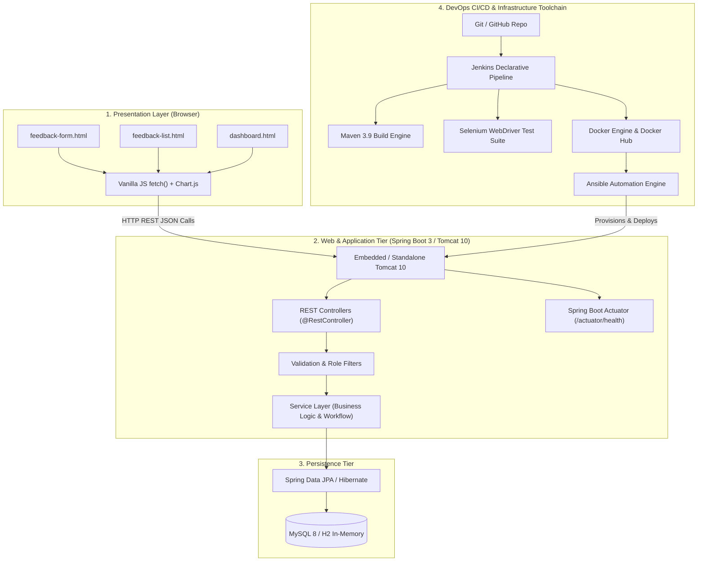

# Week 3 — Layered System Architecture & DevOps Toolchain

The diagram below details the runtime application architecture and its integration with the surrounding DevOps automation toolchain.

> **Single Deployable Unit Note**: The static frontend (`.html`, `.css`, `.js`) resides in `src/main/resources/static/` inside the Spring Boot application package. There is no separate frontend node server; Spring Boot serves the static files and the REST API from the exact same origin, eliminating CORS configurations and ensuring a single unified `.war`/`.jar` artifact.
