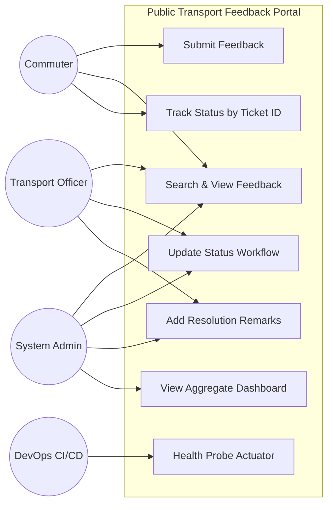

# Week 3 — Use Case Model & Diagram

---

## Detailed Use Case Descriptions

### UC-1: Submit Feedback
- **Primary Actor**: Commuter
- **Preconditions**: User navigates to `/feedback-form.html`.
- **Main Flow**:
  1. User selects transport route and category (Delay, Cleanliness, Safety, Staff).
  2. User enters feedback description and contact info.
  3. System validates input fields.
  4. System persists record with initial status `SUBMITTED`.
  5. System generates unique Ticket ID and displays success confirmation.
- **Postconditions**: Feedback saved in database; visible on dashboard and list.

### UC-4: Update Status Workflow
- **Primary Actor**: Transport Officer / Admin
- **Preconditions**: Feedback record exists.
- **Main Flow**:
  1. Officer views complaint details on `/feedback-list.html`.
  2. Officer selects next state (e.g. `IN_REVIEW` or `RESOLVED`).
  3. System validates valid transition sequence and saves new status with timestamp.
  4. UI table updates immediately via async REST call.
