# Week 15 — Final Comprehensive DevOps Release Report

## 1. Project Overview & Scope
- **Project Title**: Automated Public Transport Feedback Portal
- **Release Version**: `v1.0.0`
- **Release Tag**: `v1.0.0`
- **Core Domain**: Urban commuter grievance management across Bus, Metro, and Suburban Rail networks.

---

## 2. End-to-End DevOps Architecture & Toolchain

```mermaid
flowchart LR
    A[Git & GitHub] -->|Webhook / Polling| B[Jenkins CI]
    B -->|Build & Package| C[Maven 3.9]
    C -->|Quality Gate| D[JUnit 5 & Selenium]
    D -->|Package| E[Docker Image]
    E -->|Push| F[Docker Hub Registry]
    F -->|Continuous Deploy| G[Docker Container :9090]
    G -->|Config Mgmt & IaC| H[Ansible Automation]
    H -->|Health Probe| I[Spring Boot Actuator]
```

---

## 3. 15-Week Milestone Completion Summary

| Week | Milestone / Objective | Status | Key Deliverable Artifacts |
|---|---|---|---|
| **W1** | Problem Statement & MVP Scope Freeze | Completed | `docs/week01/problem-statement.md`, `mvp-scope.md` |
| **W2** | Agile Planning & DevOps Workflow | Completed | `docs/week02/user-stories-acceptance-criteria.md`, `devops-lifecycle-diagram.md` |
| **W3** | Requirements, Architecture & Tech Stack | Completed | `docs/week03/architecture-diagram.md`, `pom.xml`, `application.yml` |
| **W4** | Git Repository & Branch Protection | Completed | `docs/week04/branching-policy.md`, `.gitignore`, `.github/` |
| **W5** | Feature 1: Feedback Submission | Completed | `docs/week05/feature-1-submit-feedback.md`, `FeedbackController.java` |
| **W6** | MVP Completion & Conflict Resolution | Completed | `docs/week06/merge-conflict-resolution.md`, Tag `v0.1.0-mvp` |
| **W7** | Jenkins Installation & Freestyle CI Job | Completed | `docs/week07/jenkins-installation-ci.md` |
| **W8** | Pipeline as Code (`Jenkinsfile`) | Completed | `Jenkinsfile`, `docs/week08/pipeline-as-code-report.md` |
| **W9** | Selenium Automated Browser Test Suite | Completed | `src/test/java/com/ptfp/selenium/`, `docs/week09/test-plan.md` |
| **W10**| Jenkins Continuous Testing Quality Gate| Completed | `docs/week10/continuous-testing-quality-gate.md` |
| **W11**| Dockerization & Container Lifecycle | Completed | `docker/Dockerfile`, `docker-compose.yml`, `docs/week11/` |
| **W12**| Automated CD (Commit-to-Container) | Completed | `docs/week12/jenkins-docker-cd.md` |
| **W13**| Ansible Server Configuration Playbooks | Completed | `ansible/inventory.ini`, `ansible/playbook.yml`, `docs/week13/` |
| **W14**| Automated Provisioning & Rollback | Completed | `ansible/rollback.yml`, `docs/week14/` |
| **W15**| Final Release, Documentation & Viva | Completed | `docs/week15/final-devops-report.md`, `viva-qa-guide.md`, Tag `v1.0.0` |

---

## 4. Key Performance Indicators Achieved
- **Build & Test Success Rate**: $100\%$ on clean releases.
- **Selenium Test Coverage**: 5 critical user journeys automated.
- **Commit-to-Deploy Duration**: 4 minutes 12 seconds.
- **Ansible Idempotency**: Verified with `changed=0`.
- **Zero-Downtime Rollback Time**: $< 15\text{ seconds}$.
